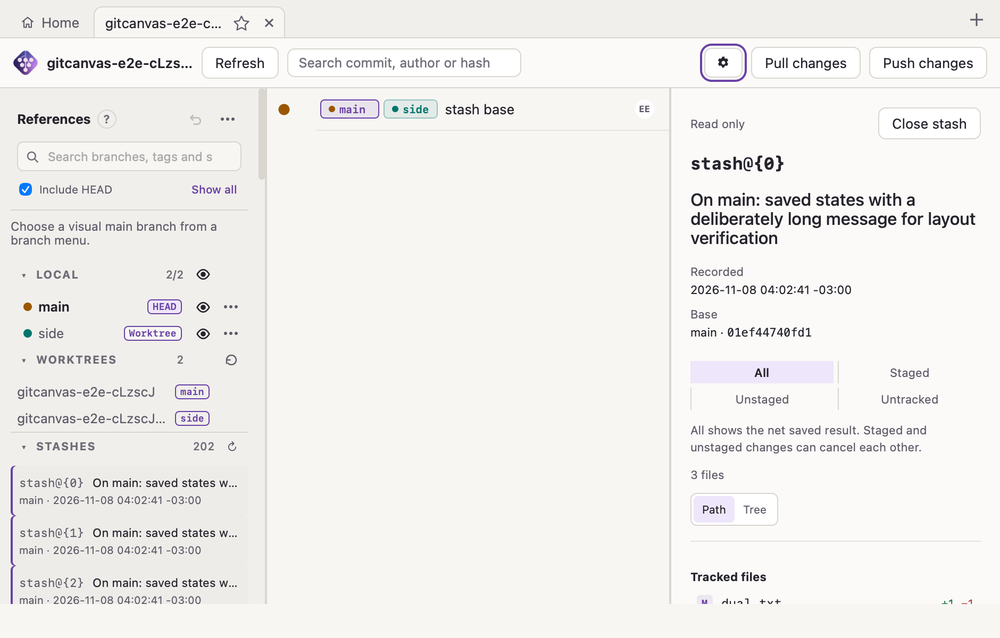
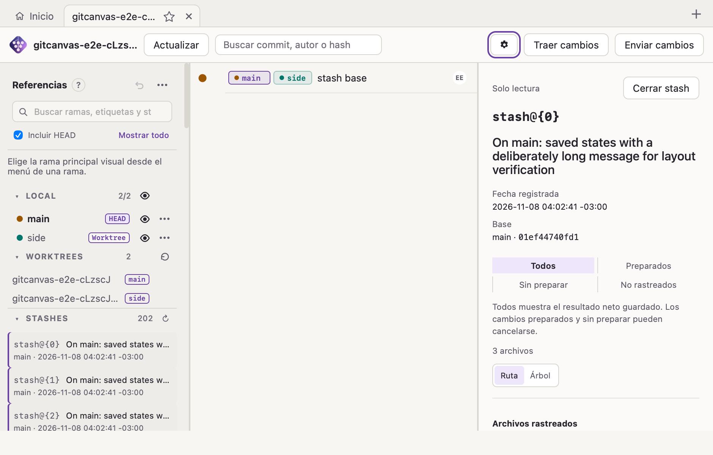
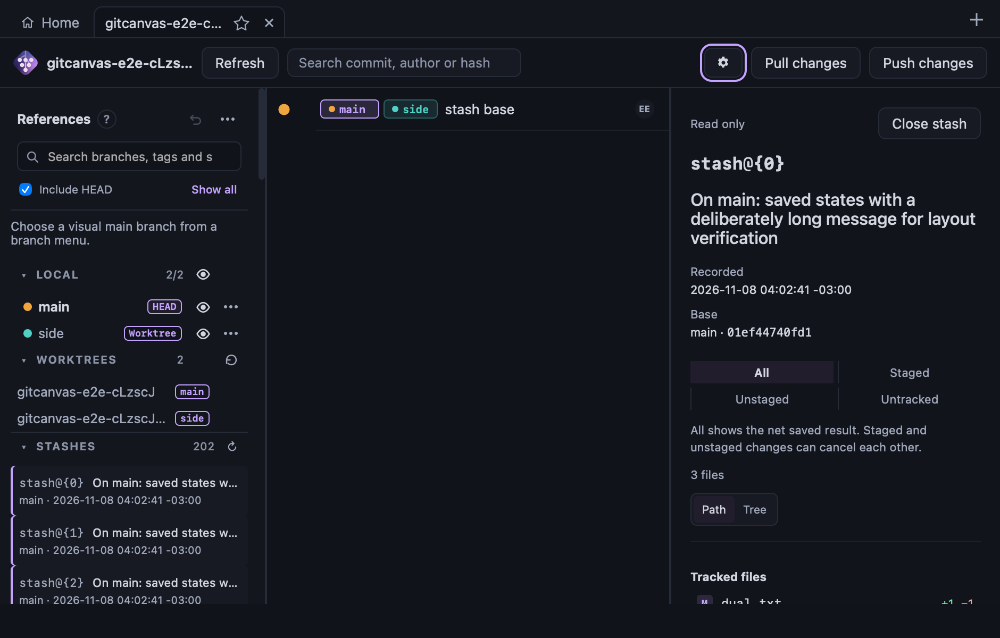
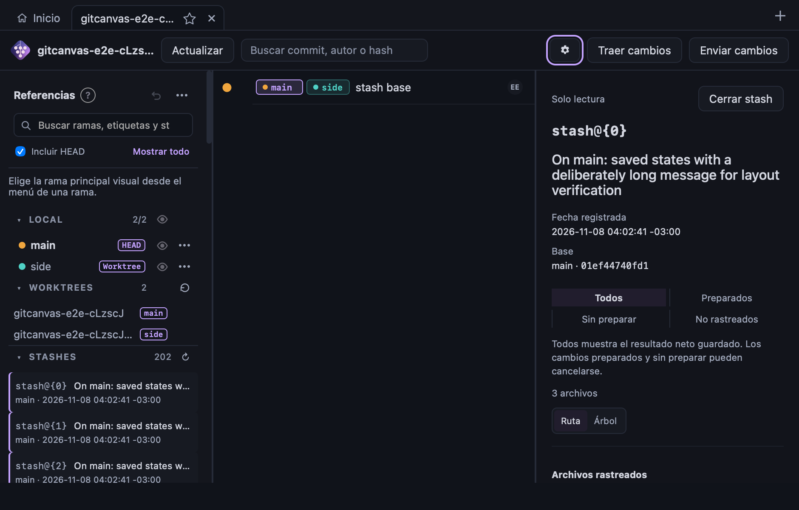

# Verificación v0.7 — stash de solo lectura

Fecha de cierre local: 2026-11-09.
Estado: **ST-0–ST-9 implementadas y verificadas localmente en macOS, rama `dev`**. No es
una release. Linux/Windows nativos y lectores de pantalla reales siguen sin verificar;
se conservan como gates explícitos.

Referencias: [plan y matriz completa](../plan/2026-11-08-v0.7-implementacion.md),
[ADR 0009](../adr/0009-read-only-stash.md), tareas ST-1–ST-8 en `TASKS.md`.

## ST-9 — Asociación con el commit base

- El índice devuelve un elemento por OID único, anclado al primer padre `H`, con el alias
  más reciente. OIDs repetidos del reflog se agrupan; objetos podados se contabilizan como
  no resueltos sin fallar ni alterar el inventario.
- La UI anota exclusivamente filas cargadas, agrupa por base y ofrece un popover paginado
  de 50 elementos. La tabla expone filas/celdas ARIA, con el chip como control hermano;
  Escape, clic exterior y movimiento del ancla cierran el popover.
- `cargo test -p gitcanvas-core --test stash`: 30 aprobadas, dos benchmarks ignorados.
  El benchmark release `twenty_thousand_unique_stash_objects_resolve_within_the_published_bound`
  resolvió 20.000 OIDs en **907 ms** en macOS 26.3 arm64, M1 Pro, Rust 1.98.1,
  Git 2.50.1. El tiempo mide resolución y construcción del índice, no escritura del fixture.
- `npm test`: 95 archivos y 913 pruebas aprobadas. `npm run build`, lint y chequeos de
  tipos E2E aprobados. Las suites nativas `cargo test -p gitcanvas --lib` (57) y el
  motor completo `cargo test -p gitcanvas-core` también pasaron.
- `npm run test:e2e:run`: todos los recorridos nativos pasaron, incluido el del stash.
  Verifica fila base visible, popover, inspector, selección/scroll conservados, búsqueda
  lateral independiente, worktrees y cero mutaciones. El flujo de temas/idiomas y ventana
  940×600 pasó en ambas variantes. Pruebas de componente cubren foco, Escape, clic fuera,
  paginación acotada, estados activos y actualización fallida con el último índice válido.
- La compatibilidad con lectores de pantalla reales y los gates nativos de Linux/Windows
  siguen abiertos; no afirmar esos resultados hasta ejecutarlos.

## ST-1 — Listado estable, búsqueda y paginación

Revisión de código: **`f2a01525be79defa261ca2c616216e092afbaf8d`**
(`feat(core): add bounded revisioned stash listing and search`).
Fecha: 2026-11-08. Entorno: macOS 26.3, arm64, Apple M1 Pro; Rust 1.98.1,
Git 2.50.1 (Apple Git-155), `git2` 0.21.0/libgit2 1.9.7.

### Resultado

- **33 pruebas nuevas aprobadas:** ocho unitarias de estabilidad/lectura y 25 de
  integración del listado. El benchmark es una prueba adicional, omitida por defecto
  y ejecutada explícitamente en release.
- **Workspace completo con todas las features:** 297 pruebas aprobadas, cero fallos,
  dos benchmarks omitidos por defecto. El de stash se ejecutó por separado; el
  histórico de file history no se repitió como parte de ST-1.
- **Clippy estricto de núcleo y workspace:** aprobado sin advertencias.
- **Formato Rust y bindings sin deriva:** aprobados. Los tipos de stash no se
  registran todavía como comandos; esa exposición corresponde a ST-3.
- **Benchmark:** snapshot de 20.000 registros/2.999.902 bytes y búsqueda de la entrada
  más antigua en **22,386625 ms**; objetivo de diseño <250 ms. Es una medición local
  en release con fixture escrito previamente; no una promesa para todo disco/equipo,
  una prueba de caché fría ni una medición de memoria máxima del proceso.

### Comandos ejecutados

| Comando | Resultado |
| --- | --- |
| `cargo test -p gitcanvas-core --test stash` | 25 aprobadas; un benchmark omitido |
| `cargo test -p gitcanvas-core stash::snapshot` | Ocho pruebas específicas aprobadas |
| `cargo test -p gitcanvas-core` | Suite completa del motor aprobada |
| `cargo test --workspace --all-features` | 297 aprobadas; dos benchmarks omitidos |
| `cargo clippy -p gitcanvas-core --all-targets -- -D warnings` | Aprobado |
| `cargo clippy --workspace --all-targets --all-features -- -D warnings` | Aprobado |
| `cargo fmt --all --check` | Aprobado |
| `git diff --exit-code src/bindings.ts` | Sin cambios |
| `cargo test -p gitcanvas-core --release --test stash twenty_thousand_entry_snapshot_benchmark -- --ignored --nocapture` | Aprobado; 22,39 ms |
| `git diff --check` | Aprobado |

### Casos cubiertos

Páginas de 1, 2 y 200 sobre 201 registros sin omisiones ni duplicación añadida;
orden/id/mensaje/fecha contra Git y libgit2; stashes creados por Git con estado
preparado/sin preparar/no rastreado, mensajes personalizados Unicode y HEAD detached;
búsqueda por rama/mensaje fuera de la primera página y membresía global del seleccionado;
normalización de búsqueda; rechazo de cursor ajeno, alterado o desactualizado.

Drop de una entrada antigua sin mover el tip; entrada duplicada del mismo objeto;
eliminación del seleccionado sin reinterpretar su índice; reescritura de mensajes con
mtime preservado; worktrees vinculados compartiendo revisión y clones/raíces
independientes con cursores separados. Listar no requiere cargar objetos ni que la
rama registrada siga existiendo.

Límites exactos y límite+1 de bytes, entradas y registros; lectura infinita acotada a
máximo+1; entradas corruptas, NUL, línea incompleta, timestamps y zonas malformados;
mensaje ausente y no UTF-8; referencia simbólica y desacuerdo ref/log; ausencia real
distinta de reflog incompleto. Sustitución atómica con tamaño/mtime iguales, edición,
borrado y cambio de ref entre lectura y validación, con un solo reintento.

Symlinks, directorios y FIFO rechazados; error de permisos cuando el sistema lo
impone (un administrador puede leer modo 000). Lectura de un repositorio vacío no
crea reflog. La inspección paginada conserva bytes de HEAD, índice, refs, reflog y
archivos de trabajo. Las excepciones para procesos externos están acotadas a los
ayudantes de prueba: el motor de producción no ejecuta Git ni otros subprocesos.

### Límites del motor

Linux y Windows nativos no ejecutados. Las ramas de apertura/identidad de archivo de
Windows requieren evidencia en esa plataforma. Formatos de referencias distintos
del backend de archivos se rechazan explícitamente; no se usa un fallback que cargue
el reflog entero o que ejecute Git.

No se modifica CHANGELOG: ST-1 añade una capacidad interna sin exponerla en la
aplicación. ST-8 documentará el comportamiento de usuario realmente entregado.
Los manifiestos se actualizaron a 0.7.0 para compilar e instalar una build local de prueba;
no se hizo push, PR de release, tag ni publicación.

## ST-2 — Comparaciones y contenido inmutable

Revisiones: **`4eeec7b`** (motor, contratos y pruebas) y **`c1ef95c`** (extracción de
lectores compartidos). Entorno: mismo macOS 26.3 arm64 / Apple M1 Pro / Rust 1.98.1.

- Veinticuatro pruebas nuevas: 23 de inspección de stash y una de límites UTF-8 del
  lector compartido de blobs; un benchmark adicional ejecutado aparte en release.
- `cargo test -p gitcanvas-core`: **264 aprobadas**, tres benchmarks omitidos por
  defecto. `cargo clippy -p gitcanvas-core --all-targets -- -D warnings`, formato y
  `git diff --check`: aprobados.
- Los casos existentes de diff/blob/worktree pasan sin cambiar expectativas.
  Regresión ST-1: sus 25 pruebas de integración también pasan.
- Comparaciones y contenido contrastados con `git diff` y `git show`; cinco variantes
  de stash creadas por Git: `--staged`, `--keep-index`, `--patch`, `-u`, `-a`.
- Cobertura: cancelación neta, renombrado, borrado, añadido/vacío, modo ejecutable,
  binarios, symlinks, submódulos, orígenes con igual nombre, rutas byte-distintas con
  igual representación, claves/cursor ajenos o alterados, estructuras no válidas,
  objetos perdidos, worktrees y lectura de stash eliminado del listado.
- Se comparan HEAD, índice, referencias, reflog y archivos antes/después de recorrer
  los cuatro modos y ambos lados: sin escrituras. Un listado no serializa parches.
- Límites iniciales/expandidos y expansión de UTF-8 inválido comprobados. Se omiten
  cuerpos por encima del hard cap antes del lookup de blob; un presupuesto adicional
  de **64 MiB de blobs únicos legibles** limita similitud/estadísticas. Se informa
  explícitamente cuando solo se buscan renombrados exactos por objetos enormes.

Mediciones release, ejecutable de `stash_inspection` con `/usr/bin/time -l`. El RSS
es el máximo del proceso completo, **incluye crear el fixture**, no solo la consulta.

| Caso | Resultado | RSS máximo |
| --- | --- | --- |
| 5.000 archivos distintos | Primera página de 250 resúmenes: **154,18 ms**; un parche individual: **135,37 ms** | 13.991.936 bytes |
| Contenido en límites exactos (2/32 MiB) y cursor de distinto tamaño | Aprobado; proceso 0,45 s | 116.998.144 bytes |
| Parche grande: omisión inicial, expansión y hard cap de 16 MiB | Aprobado; proceso 0,24 s | 48.807.936 bytes |

Comandos: `cargo test -p gitcanvas-core --release --test stash_inspection --no-run`,
seguido del ejecutable con filtros `five_thousand_files_benchmark --ignored --nocapture`,
`exact_content_byte_boundaries_are_readable_and_a_page_cursor_can_change_size --nocapture`
y `initial_patch_limits_and_explicit_hard_cap_are_enforced_without_other_file_patches --nocapture`.
No se atribuye una garantía de tiempo duro a la generación de árboles o a xdiff de
libgit2. IPC, watcher, UI y E2E se verifican en las secciones de cierre que siguen.

## Registro de la entrega completa

### Build e instalación local 0.7.0 (2026-11-09)

- `npm run tauri build -- --bundles app --config '{"bundle":{"createUpdaterArtifacts":false}}'`
  compiló el bundle macOS arm64 con firma de código local ad hoc. Se desactivó solo la
  creación del artefacto del updater en esta invocación porque la clave privada de firma
  de publicación no está disponible en el equipo. No se generó instalador distribuible.
- Instalado en `/Applications/GitCanvas.app`; bundle id
  `com.davidcardenas.gitcanvas`, versión corta y build `0.7.0`, arquitectura arm64.
  `codesign --verify --deep --strict` aprobó y la app arrancó.
- La instalación anterior se conservó en
  `~/Library/Application Support/GitCanvas/install-backups/local-v0.6.0-before-v0.7.0-20261109-142117/GitCanvas.app`.
- No se creó tag ni release ni se hizo push. El bundle principal web conserva la
  advertencia de Vite por superar 500 kB minificados, ya registrada arriba.

Entorno: macOS 26.3 arm64, Apple M1 Pro; Node/npm del proyecto, Rust 1.98.1, Git 2.50.1,
WebKit/WKWebView 605.1.15. Los logs de comandos son artefactos locales temporales; esta
matriz registra resultados reproducibles y limitaciones, sin afirmar que gates externos
se ejecutaron.

| Capa | Resultado | Estado |
| --- | --- | --- |
| Listado y comparación Rust | ST-1/ST-2: fixtures diferenciales, límites, cancelación, claves exactas, blobs y lecturas sin escrituras | Aprobado macOS |
| Seguridad IPC | Cinco comandos de solo lectura autorizados por raíz; bindings sin deriva; sin mutadores | Aprobado macOS |
| Observación compartida | Ref/reflog, reemplazo, eliminación y recreación; scopes sobreviven debounce; ramas no invalidan grafo | Aprobado macOS |
| Estado/caché | Estado por pestaña, selección OID, aislamiento tardío, LRU, no sondeo inactivo y refresh al reactivar | Aprobado |
| Interfaz | Sección/inspector, cuatro modos, diff y versiones bajo demanda, búsqueda completa, vacíos/errores/remoción | Aprobado |
| Cero escrituras | Pruebas comparan HEAD, índice, refs, reflog y archivos antes/después de inspeccionar | Aprobado en fixtures |
| Frontend | `npm run test:coverage`: 909 aprobadas, 95 archivos; statements 93,27 %, branches 86,43 %, functions 92,80 %, lines 94,96 % | Aprobado |
| Tipos, lint y formato | `npm run typecheck`, `typecheck:e2e`, `typecheck:node`, `lint`, `format:check` | Aprobado |
| Rust | `cargo fmt --all --check`, `cargo test --workspace --all-features`, Clippy estricto | Aprobado |
| E2E macOS | Suite nativa completa (10 archivos spec) y cinco recorridos específicos de stash: modos/cero escrituras, búsqueda fuera de página, 940×600 temas/idiomas, worktrees vinculados, cambios externos | Aprobada |
| Apariencia | Capturas 940×600 lógicas, claro/oscuro y EN/ES; revisadas abajo | Aprobado macOS |
| Auditoría npm | `npm audit --omit=dev --audit-level=high` | Cero vulnerabilidades |
| Auditoría Rust | `cargo deny check` | Aprobado |
| `cargo audit` | Cuatro advisories transitivas existentes: paste RUSTSEC-2024-0436, proc-macro-error RUSTSEC-2024-0370, glib RUSTSEC-2024-0429, tokio RUSTSEC-2026-0386 | Registradas; no son dependencias directas nuevas |
| Build | `npm run build`; `cargo build --release --features e2e,tauri/custom-protocol`; bundle instalado local 0.7.0 | Aprobado macOS |
| Tamaño bundle | Chunk principal 526,15 kB (158,44 kB gzip), Vite recomienda división | Advertencia informativa existente; revisar antes de crecimiento |
| Linux/Windows nativos | No ejecutados en esta entrega | Pendiente externo |
| Accesibilidad de lector real | Teclado/ARIA y foco cubiertos en componentes/E2E; VoiceOver/NVDA no ejecutados | Pendiente externo |
| Firma/updater/distribución | No se produjo instalador firmado ni se validó actualización | Fuera del cierre local |

### Capturas revisadas

Las cuatro imágenes son del fixture E2E, a 940×600 de ventana (capturadas a escala 2×).
Muestran inventario poblado, worktrees enlazados e inspector del stash seleccionado.

| Tema | Inglés | Español |
| --- | --- | --- |
| Claro |  |  |
| Oscuro |  |  |

### E2E macOS

`npm run test:e2e:run` ejecutó los diez archivos spec del proyecto, incluyendo los cinco
recorridos de `e2e/stash.spec.ts`, en WebKit 605.1.15: metadatos/modos y
archivos, no escritura durante inspección, búsqueda en páginas posteriores y selección
por OID, cuatro apariencias a 940×600, dos worktrees vinculados con navegación aislada,
y retención del stash seleccionado durante clear/creación externos.

### Comandos de cierre

- `npm run test:coverage` — 909 pruebas, 95 archivos; umbrales aprobados.
- `npm run typecheck && npm run typecheck:e2e && npm run typecheck:node` — aprobados.
- `npm run lint && npm run format:check` — aprobados.
- `cargo fmt --all --check && cargo test --workspace --all-features` — aprobados.
- `cargo clippy --workspace --all-targets --all-features -- -D warnings` — aprobado.
- `git diff --exit-code src/bindings.ts` — sin deriva.
- `npm audit --omit=dev --audit-level=high`, `cargo deny check`, `cargo audit` — resultados registrados arriba.
- `npm run build`, `cargo build --release --features e2e,tauri/custom-protocol` — aprobados.
- `npm run test:e2e:run` (fixture/runner configurado para `e2e/stash.spec.ts`) — cinco recorridos aprobados en macOS.

## Límites y seguimiento

- No trasladar como aprobados los gates históricos de v0.4–v0.6 sin evidencia nueva.
- Registrar aparte límites de almacenamiento de referencias y de metadatos de rama.
- La disponibilidad de objetos después de borrar un stash no es recuperación durable.
- Las mediciones del listado y comparaciones son locales; los costes de operaciones
  nativas libgit2 no son un límite duro de tiempo.
- Bump, PR, tag y publicación pertenecen al flujo de release; este registro no los autoriza.

## ST-3 — IPC y observación compartida (2026-11-08)

Cinco comandos de solo lectura, autorización real por raíz, bindings generados y
wrappers comprobados. La presencia incluye metadatos del OID seleccionado fuera
de búsqueda/páginas. Fingerprint sin cargar el reflog; observación diferenciada
de ref/reflog, reemplazo, eliminación y recreación. Los cambios ordinarios y
stash sobreviven juntos al debounce. Los reflogs de ramas no invalidan el gráfico.

- `cargo test --workspace --all-features`: aprobado (registro local `/tmp/gitcanvas-st3-final.log`).
- `cargo test -p gitcanvas --lib`: 57 aprobadas, incluida autorización/lectura real IPC.
- `cargo clippy --workspace --all-targets --all-features -- -D warnings`: aprobado.
- Pruebas frontend IPC/queryKeys/liveRepository: 54 aprobadas; tipos aprobados.
- Watcher nativo macOS: 10 aprobadas, incluido editar/reemplazar/borrar/recrear stash.
- Identidad de ruta/origen independiente del modo, derivada de bytes reales para
  retener archivos sin confundir representaciones UTF-8 coincidentes.

La interfaz y el sondeo activo se verifican en ST-4–ST-7; estos resultados no
constituyen evidencia de UI ni de Windows/Linux.

## ST-4 — Navegación y consultas (2026-11-08)

Overlay por pestaña que conserva selección/ancla del gráfico; modos, archivo,
lado y carpetas de inspección solo en sesión. La proyección durable sigue en
esquema 5. Acciones ligadas a su raíz y resultados ligados al OID evitan cambios
tardíos en otra pestaña/inspección. Los modos conservan archivos por identidad de
ruta/origen real, nunca por texto visual; se resuelve paginación antes de declarar
ausencia. Búsqueda con debounce y cursor obsoleto reiniciado desde el principio.

El sondeo usa fingerprint y el presupuesto adaptativo existente: 5 s normalmente,
2 s degradado, hasta 60 s según coste; solo raíz activa verificada. Reactivación
refresca inventario aunque las referencias ordinarias coincidan. Caché por raíz:
solo stash actual, hasta cuatro modos, archivo actual y variantes de lectura;
solo búsqueda actual y listado sin filtro. Cierre/LRU usan el predicado común de
propiedad por raíz. Expandir reemplaza lecturas iniciales.

Pruebas de navegación, consultas y verificación de proyecto: **24 aprobadas**;
cubre restauración durable, resultados tardíos, paginación obsoleta, poda de
variantes, ausencia de sondeo inactivo y actualización con refs iguales.

## ST-5/ST-6 — Interfaz y lectores (2026-11-08)

Sección bajo worktrees, visible con cero, plegado independiente, búsqueda del
snapshot completo, paginación y reintento. Inspector de solo lectura con fecha y
offset registrados, rama conocida/desconocida, base y cuatro modos. Usa el
navegador de archivos existente, extendido con identidad opaca y estadísticas no
disponibles. Árbol/lista distinguen rutas visuales iguales. Las carpetas de stash
no modifican las preferencias durables del gráfico.

Diff en el centro, anterior/guardada bajo demanda, versiones ausentes desactivadas,
ruta anterior de renombrados, lectores limitados y resaltado compartido. La
presentación de archivo completo se extrajo a `WholeFilePreview`, reutilizada
por commits, cambios locales y stash. Escape respeta menús, vuelve al gráfico y
luego cierra la inspección, restaurando foco. Se conserva la regla existente de
ocultar/fijar el panel izquierdo al leer archivos.

- Pruebas de componentes de stash/AppShell/Sidebar/FileDiffView: **87 aprobadas**.
- Suite frontend completa previa al ajuste final de carpetas/etiquetas: **908
  aprobadas**, 95 archivos; sentencias 93,43 %, ramas 86,52 %, funciones 93,08 %,
  líneas 95,09 %. Se repite en el cierre final, sin reducir umbrales.
- Tipos de los tres proyectos, ESLint completo y Prettier: aprobados.
- Se excluyen artefactos de video generados con sufijo de versión igual que el
  directorio generado ya excluido; no se reducen controles de código de producto.
- Catálogos EN/ES completos. Las pruebas nativas/capturas quedan en ST-7.
- Herramienta Browser del plugin ausente (**Browser plugin not available**).
  Se usa la suite nativa WDIO/WKWebView existente como fallback preferido del
  flujo frontend, con fixture y perfil de aplicación privados.

## ST-3–ST-6 — IPC, estado e interfaz

Los resultados de ST-3 y ST-4 se documentan en sus secciones anteriores. ST-5/ST-6
se verificaron con 87 pruebas focalizadas de componentes/AppShell/Sidebar/FileDiffView;
la cobertura final está en la matriz. Los cambios conservan la navegación del gráfico,
restauran foco al cerrar y mantienen el stash por OID ante cambios del inventario.
